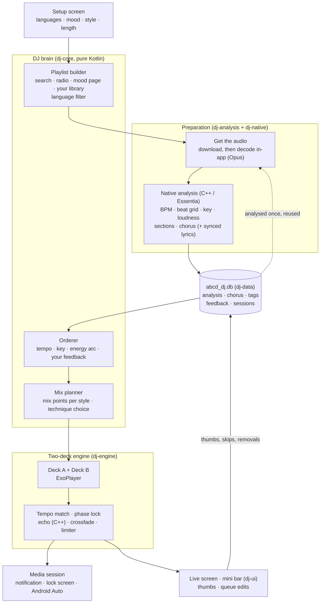

<div align="center">

# abcd · Anybody Can DJ

**An automatic DJ for Android. Pick a vibe, press start, and abcd plays one continuous, beat-matched mix.**

Built for house parties and road trips, India first: Hindi, English, Punjabi, Tamil, Telugu and more.

</div>

---

## What it does

1. **You choose** one or more languages, a mood (Party, Chill, Romantic, Road Trip, Workout, Sad,
   Retro, Devotional, Wedding/Sangeet), a mix style and how long the mix should run.
2. **abcd picks the songs** from YouTube Music: searches for your languages and mood, "up next" radio
   from the best picks, YouTube Music's own mood page, and your liked and library songs.
3. **abcd listens to every song before it plays.** On the phone, it finds the tempo (BPM), the beat
   grid, the musical key, loudness, the song's sections and its chorus.
4. **abcd orders the set** so that tempo, key and energy flow, following an energy arc that suits the mood.
5. **abcd mixes it live** on two decks: it lines up the beats, matches the tempo without changing the
   pitch, and blends one song into the next at the right moment.

### Mix styles

| Style | What you hear |
|---|---|
| **Smooth** | Long blends. Each song plays until after its last chorus. |
| **Radio** | Songs play almost to the end, then mix into the next one. |
| **Chorus Hits** | A fast mix: each song plays its main chorus, then jumps to the next song's chorus. |

### Transitions

| Technique | When abcd uses it |
|---|---|
| **Beat-matched blend** | Both songs have a clear beat and their tempos are within about 6% (half- or double-time counts). The incoming song is time-stretched, phase-locked to the beat and faded in over 8 to 16 bars; the two basslines swap in the middle so the kicks never double up. The blend is shorter when the keys clash. |
| **Echo out** | The tempos are too far apart to blend. The outgoing song echoes out on the beat and the next song drops in on its downbeat. |
| **Classic fade** | Neither of the above is possible, for example when there is no usable beat grid. |

### While the mix plays

- Now playing and up next, with artwork, on the **live screen** and in a **mini bar** on every tab.
- **Thumbs up / down** on the transition that just happened.
- **Edit the queue:** move songs up or down, remove a song, or mark it "never play".
- A **timeline** of the playing song: its waveform, where the next mix will happen, a countdown and a
  beat pulse.
- Play/pause, Next and End session, including from the notification and the lock screen.
- **abcd learns from you.** Banned songs never come back, songs you often remove or skip sink, and
  song pairs and transition styles you liked are chosen more often. Everything stays on your phone.

---

## How it works



**Step by step**

1. **Build.** The playlist builder asks YouTube Music for candidates and keeps only songs that match your
   languages. It uses script detection (Devanagari, Gurmukhi, Tamil and more), Hindi and Punjabi words in
   Latin-script titles, and artist hints, and checks again against the lyrics after analysis. It drops
   podcasts, very long tracks and banned songs. Your own corrections in the Lab always win.
2. **Prepare.** Every song is analysed **before** it plays. The audio is decoded in-app and passed to a
   native C++ analyser built on [Essentia](https://essentia.upf.edu/). Results are saved in abcd's own
   database, so a song is analysed only once. Your second mix starts much faster than your first.
3. **Order.** Songs are ordered by tempo compatibility, Camelot-wheel key compatibility and how well
   their energy fits the arc for your mood (for example, Party builds up). Your past feedback nudges
   the order.
4. **Plan each transition.** For each pair of songs, the mix planner picks where to leave the playing
   song and where to enter the next one (on a bar line, around choruses for Chorus Hits), then picks a
   technique and its length.
5. **Play.** Two decks play at once. The incoming deck is cued silently at the matched tempo and
   continuously nudged until its beats line up with the playing deck, usually within a few
   milliseconds. Then a constant-power crossfade with a little headroom and a limiter makes the
   change hard to hear.

### Project layout

| Module | What it holds |
|---|---|
| `dj-core` | Pure Kotlin, no Android: session settings, playlist builder, language and mood tagging, ordering and scoring, mix planner, feedback logic. Unit-tested on the JVM. |
| `dj-native` | C++ (NDK + CMake): Essentia-based analysis, echo effect, JNI bindings. |
| `dj-analysis` | Android audio decoding (in-app Opus decoder or MediaCodec) and the analysis pipeline. |
| `dj-data` | The DJ's own Room database `abcd_dj.db`: analyses, sections, chorus segments, tags, feedback, sessions. |
| `dj-engine` | The two-deck mixing engine on Media3 ExoPlayer, its audio processors and media-session player. |
| `dj-ui` | Jetpack Compose screens: setup, preparing, live screen, mini bar, Lab (developer tools). |
| `androidApp`, `shared` | The music app abcd is built on: YouTube Music access, player, library, downloads and settings. |

Design notes live in [`docs/`](docs/): the product brief ([`ABCD_rev2.md`](docs/ABCD_rev2.md)), the
engine design ([`DJ_ENGINE_DESIGN.md`](docs/DJ_ENGINE_DESIGN.md)), the build plan
([`STAGES.md`](docs/STAGES.md)) and the decision log ([`DECISIONS.md`](docs/DECISIONS.md)).

---

## Status

abcd is in **alpha** (`1.0.0-alpha1`), Android only, and distributed as an APK. v1 is complete:
analysis, the two-deck engine, beat-matched and echo transitions with a bass swap, the live screen with
its timeline, and learning from feedback. A chorus editor is planned for v2. See
[`docs/STAGES.md`](docs/STAGES.md).

## Build it yourself

Requirements: Android Studio (JDK from Gradle toolchains), Android SDK, NDK `30.0.16248370` and CMake `4.1.2`.

```bash
git clone https://github.com/vibs-c/abcd.git
cd abcd
git submodule update --init          # libopus, Essentia, Eigen and other native sources
./gradlew :androidApp:assembleDebug  # APK in androidApp/build/outputs/apk/debug/
./gradlew :dj-core:jvmTest           # DJ brain unit tests
```

On Windows, use `.\gradlew.bat`. For the x86_64 emulator, add `-Pabcd.opusX86=true` so the in-app Opus
decoder is built for it too.

## Privacy

- No analytics, no telemetry and no crash reports. Analysis results, tags and feedback stay in a database
  on your phone.
- abcd talks to YouTube Music the same way the underlying app already does. DJ Mode adds no new servers
  or endpoints.

## License and credits

abcd is licensed under the **GNU AGPL-3.0** because it links [Essentia](https://essentia.upf.edu/)
(AGPL-3.0). See [`LICENSE`](LICENSE), [`LICENSES/`](LICENSES/) and [`NOTICE.md`](NOTICE.md) for the full
notices.

abcd is built on [Metrolist](https://github.com/MetrolistGroup/Metrolist) (GPL-3.0), an open-source
YouTube Music client, with thanks to its developers.

> [!WARNING]
> abcd is not affiliated with, funded, authorized or endorsed by YouTube or Google LLC. Using a
> third-party client to access YouTube Music may violate YouTube's Terms of Service; you use abcd at your
> own risk. All trademarks belong to their respective owners.
